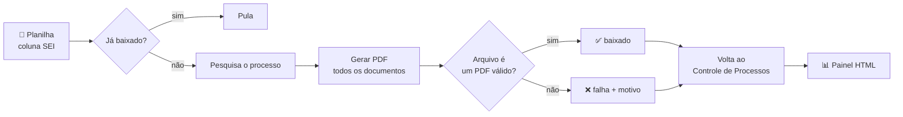
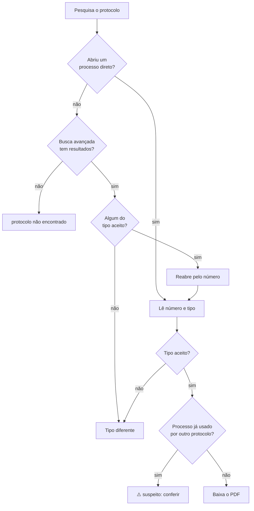

<div align="center">

# 📥 Automação SEI — Download de PDFs de Processos

**Localiza processos no SEI a partir de uma planilha e baixa o PDF completo de cada um, em lote e sem supervisão, com conferência do arquivo, retomada automática e painel de acompanhamento.**

[](https://www.python.org/)
[](https://playwright.dev/python/)
[](https://openpyxl.readthedocs.io/)


**Outras automações SEI:** [Parte 1: Criação de processos](https://github.com/ThiagoDionisio05/sei-automacao) •
[Parte 2: Documentos pessoais](https://github.com/ThiagoDionisio05/sei-automacao-pt2) •
[Parte 3: Documentos nativos](https://github.com/ThiagoDionisio05/sei-automacao-pt3)

</div>

---

## 📌 Visão geral

Baixar o PDF de um processo no SEI é simples. Fazer isso **centenas de vezes** não é: abrir o sistema, pesquisar o número, conferir se é o processo certo, clicar em "Gerar PDF", escolher os documentos, baixar e repetir. São dezenas de horas de trabalho manual.

Este projeto transforma isso num lote que roda sozinho. Em uso real, ele já baixou **mais de 260 PDFs de processos**.

Há **dois fluxos**, para dois tipos de planilha:

| Fluxo | Entrada | O que faz |
|---|---|---|
| **Por número de processo** (`main.py`) | Número do processo (coluna `SEI`) | Pesquisa, gera e baixa o PDF completo |
| **Por protocolo** (`main_protocolo.py`) | Só o número de protocolo | Descobre o processo, **confere o tipo** e só baixa se for um dos tipos aceitos |

### Destaques

| | |
|---|---|
| 🔐 **Seguro por design** | Login sempre manual; nenhuma senha ou sessão no código |
| ✅ **Confere o arquivo, não só o clique** | Um PDF só conta como baixado se existir, não estiver vazio e começar com a assinatura `%PDF-` |
| 🧭 **Classificação antes do download** | No fluxo por protocolo, só baixa processos dos tipos aceitos |
| 🛡️ **Duas camadas contra resultado errado** | Corrige a causa de um bug de autocomplete **e** detecta quando o mesmo processo aparece para dois protocolos |
| ♻️ **Retomável** | Cada resultado é gravado na hora; rodar de novo continua de onde parou |
| 📊 **Painel e planilha de saída** | HTML com contagens, busca e filtro, e uma planilha `.xlsx` com o resultado |

---

## ⚙️ Como funciona

### Fluxo por número de processo



### Fluxo por protocolo



---

## 🧠 Desafios de engenharia e bugs reais

Esta foi a parte mais instrutiva do projeto: bugs encontrados rodando contra o sistema real, não em cenários de laboratório.

<details>
<summary><b>1. Um BOM invisível esvaziando uma coluna inteira</b></summary>

<br>

**Sintoma:** uma planilha sempre retornava a coluna "Protocolo" vazia, em todas as linhas.

**Causa:** o arquivo tinha um BOM UTF-8 no início. Lido com o encoding errado, esses bytes viravam caracteres invisíveis colados no nome do cabeçalho (`"Protocolo"` virava `"Protocolo"`).

**Correção:** `encoding="utf-8-sig"` na leitura, que remove o BOM automaticamente.

**Lição:** quando um campo vem sempre vazio, vale olhar os *bytes brutos* do arquivo antes de suspeitar de outra coisa. O problema é invisível num editor comum.

</details>

<details>
<summary><b>2. Mesma tela, estado diferente</b></summary>

<br>

**Sintoma:** o botão de gerar PDF não existia na tela, mesmo com o processo certo aberto.

**Causa:** dois caminhos diferentes levavam à "mesma" tela. Um abria o processo em si, com a barra de ferramentas completa; o outro abria um documento específico dentro dele, sem essa barra.

**Correção:** um clique explícito no número do processo para trocar de contexto antes de procurar o botão.

**Lição:** "parece a mesma tela" não é o mesmo que "é o mesmo estado". Vale conferir o caminho percorrido até ali, não só a aparência final.

</details>

<details>
<summary><b>3. Condição de corrida no autocomplete</b></summary>

<br>

**Sintoma:** num lote de 100 execuções, vários protocolos diferentes foram associados ao **mesmo** processo. Um erro sério, porque atribuiria o documento errado a registros diferentes.

**Causa:** o campo de busca tinha uma lista de sugestões com o histórico. Às vezes a tecla Enter era capturada pelo autocomplete, que escolhia uma busca anterior em vez de enviar o texto recém-digitado.

**Correção em duas camadas:**
1. fechar qualquer sugestão aberta (`Escape`) e conferir o valor do campo antes de confirmar;
2. detectar em tempo real quando um processo já foi usado por outro protocolo do lote, e marcar o caso como suspeito em vez de aceitar sem avisar ([`status_protocolo.py`](src/status_protocolo.py)).

**Lição:** bugs intermitentes costumam vir de **estado escondido** da interface. Lotes grandes revelam padrões que testes pequenos não mostram, então vale auditar o resultado agregado (valores repetidos onde não deveriam existir), não só item a item.

</details>

<details>
<summary><b>4. Uma camada de segurança mal calibrada é pior que nenhuma</b></summary>

<br>

**Sintoma:** depois do bug acima, uma checagem extra (conferir se o texto buscado aparecia na tela) passou a rejeitar dezenas de resultados que estavam certos.

**Causa:** o texto só aparecia dentro de um visualizador de PDF embutido (iframe), cujo conteúdo nem sempre fica disponível como texto a tempo da checagem.

**Correção:** remover essa camada, já que a causa raiz tinha sido corrigida na origem.

**Lição:** uma salvaguarda "por garantia" também pode ter bugs e precisa da mesma validação que o problema original.

</details>

<details>
<summary><b>5. Uma falha no último passo não deveria custar o trabalho inteiro</b></summary>

<br>

**Sintoma:** depois de um lote inteiro rodar com sucesso, o script travava ao gravar a planilha final, com erro de permissão.

**Causa:** o arquivo de saída estava aberto no Excel, e o Windows bloqueia a escrita.

**Correção:** capturar esse erro específico e gravar num arquivo alternativo com aviso, em vez de interromper depois que todo o trabalho pesado já tinha sido feito.

**Lição:** vale sempre perguntar "se este passo final falhar, o que eu perco?".

</details>

---

## 🚀 Como rodar

### Pré-requisitos

- Python 3.10+, Google Chrome e acesso a uma instância do SEI

### 1. Instalação

```powershell
git clone https://github.com/ThiagoDionisio05/sei-download-pdfs.git
cd sei-download-pdfs
python -m venv .venv
.venv\Scripts\activate
pip install -r requirements.txt
playwright install chromium
copy src\config_local.example.py src\config_local.py   # URL do SEI e nome da planilha
```

### 2. Planilhas de entrada

- **Fluxo por número de processo:** um CSV com a coluna `SEI`, apontado em `PLANILHA_PROCESSOS` no `config_local.py`.
- **Fluxo por protocolo:** um CSV `relatorio_lista_de_tarefa*.csv` na pasta do projeto, com a coluna `Protocolo`. O arquivo mais recente é escolhido automaticamente.

### 3. Abra o Chrome com depuração remota e faça login no SEI

```powershell
& "C:\Program Files\Google\Chrome\Application\chrome.exe" `
  --remote-debugging-port=9222 `
  --remote-debugging-address=127.0.0.1 `
  --user-data-dir="C:\ChromeSEIAutomacao"
```

> [!WARNING]
> A porta 9222 não tem autenticação. Abra essa janela **só durante a execução** e feche-a ao terminar.

### 4. Execute

| Comando | O que faz |
|---|---|
| `python buscar_processo.py` | Teste: baixa só o primeiro processo pendente |
| `python main.py --limite 5` | Baixa os 5 próximos processos pendentes |
| `python main.py` | Baixa todos os pendentes da planilha |
| `python main_protocolo.py --limite 10` | Fluxo por protocolo, só os 10 próximos |
| `python main_protocolo.py` | Fluxo por protocolo, todos os pendentes |
| `python gerar_relatorio.py` | Regera o painel `relatorio_downloads.html` |
| `python gerar_relatorio_protocolo.py` | Regera `relatorio_protocolos.html` e `planilha_resultado.xlsx` |

---

## 📁 Estrutura do projeto

```
sei-download-pdfs/
├── main.py                       # Orquestrador: fluxo por número de processo
├── main_protocolo.py             # Orquestrador: fluxo por protocolo + classificação
├── buscar_processo.py            # Teste com um único processo
├── gerar_relatorio.py            # Painel HTML do fluxo por processo
├── gerar_relatorio_protocolo.py  # Painel HTML + planilha .xlsx do fluxo por protocolo
├── requirements.txt
└── src/
    ├── config.py                 # Caminhos, URL do SEI, tempos de espera
    ├── config_local.example.py   # Modelo para os dados reais (não versionados)
    ├── browser.py                # Conexão com o Chrome via CDP
    ├── sei_page.py               # Pesquisa, cliques, leitura de número e tipo
    ├── pdf_processo.py           # Gera, baixa e valida o PDF
    ├── protocolo_processo.py     # Pesquisa → classificação → download
    ├── planilha_protocolo.py     # Leitura do CSV de protocolos
    ├── status_pdf.py             # Registro de PDFs baixados e falhas
    └── status_protocolo.py       # Registro por protocolo + detecção de conflito
```

Um padrão se repete em todo o código: **orquestradores finos na raiz**, chamando funções especializadas e de responsabilidade única em `src/`.

---

## 📚 O que aprendi

- **Ler os bytes, não só o texto:** encoding e BOM explicam muitos "campos vazios".
- **Estado da interface importa:** a mesma tela pode estar em estados diferentes.
- **Auditar o lote, não só o item:** valores repetidos onde não deveriam existir denunciam bugs intermitentes.
- **Salvaguardas também precisam de teste:** uma checagem mal calibrada pode atrapalhar mais do que proteger.
- **Proteger o trabalho já feito:** uma falha no último passo não deve derrubar horas de execução.

---

## ⚠️ Aviso

Projeto independente, criado para uso pessoal e fins de estudo. **Não é afiliado nem endossado** por nenhum órgão público ou pelos mantenedores do SEI. Use apenas em sistemas aos quais você tem acesso autorizado e de acordo com as políticas da sua instituição. Nenhuma planilha, PDF baixado, print ou arquivo de status faz parte deste repositório, porque contêm dados pessoais de terceiros.

Código disponibilizado apenas para consulta, como portfólio. Nenhuma licença de uso é concedida.

<div align="center">

Feito por **Thiago Dionisio** · [GitHub](https://github.com/ThiagoDionisio05)

</div>
